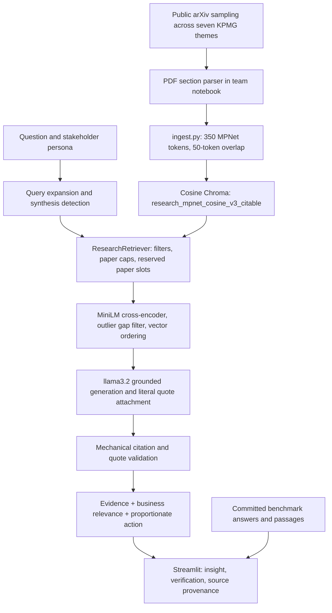

# AI Research Intelligence Agent for Business Insight Translation

Break Through Tech AI Studio · KPMG · Fall 2026

---

### 👥 **Team Members**

| Name | GitHub Handle | Contribution |
| --- | --- | --- |
| Kathleen Higgins | @kathigg | RAG evaluation and KPI |
| QiQi Li          | @qiqi0211| EDA, RAG evaluation, and prompt engineering | 
| Thien Nguyen     | @Trungu | EDA, LangChain Pipeline Dev | 

---

## 🎯 **Project Highlights**

The prototype helps KPMG stakeholders find public AI research, inspect supporting
evidence, and consider proportionate business applications. Stakeholders review
interpretations before internal decisions, thought leadership or client discussions.

**Business Insight = What the Study Found (Evidence) + Why It Matters to KPMG
(Business Relevance) + What KPMG Could Consider (Proportionate Action & Guardrails).**

Findings remain passage-cited and traceable to source text. Business relevance
connects research to potential Audit, Tax or Advisory workflows. Actions are
bounded pilot proposals with human review and explicit limitations, rather than
promises of client outcomes or ROI.

## 👩🏽‍💻 **Setup and Installation**

Use Python 3.12, the version exercised by CI. From a fresh clone:

```bash
git clone https://github.com/Break-Through-Tech/KPMG-1C-ai-research-intelligence-agent-for-business-insight-translation.git
cd KPMG-1C-ai-research-intelligence-agent-for-business-insight-translation
python -m venv .venv
```

Activate with `.venv\Scripts\Activate.ps1` in PowerShell or
`source .venv/bin/activate` on macOS/Linux, then:

```bash
pip install -r requirements.txt
pytest -q
streamlit run app.py
```

The launch command requires the companion UI PR and its business-translation
prerequisite to be merged. The default saved-benchmark mode needs no Ollama
service, embeddings download or Chroma index. It exposes all 25 committed
questions and five sample paper insights, including abstentions and warnings.
Retrieval controls apply only to live mode; they do not rerun saved answers.

For live RAG:

1. Follow the team's [notebook setup notes](evaluation/README.md). Prepare metadata,
   parse PDFs and initialize normalized `sentence-transformers/all-mpnet-base-v2`
   embeddings in `notebooks/eda_workbook.ipynb`. Build the citable Chroma collection
   under `arxiv_data/chroma_db`. The notebook also needs a Jupyter kernel, which
   is not required for the UI or offline tests.
2. Run the notebook's retrieval cells to cache
   `cross-encoder/ms-marco-MiniLM-L6-v2`. The UI loads locally cached models only.
3. Install Ollama separately, run `ollama pull llama3.2`, and start `ollama serve`
   if it is not already running. The UI uses `http://127.0.0.1:11434`.
4. Launch Streamlit, select a stakeholder persona and choose live mode. Set a
   collection area or conservative auto-routing, top-k chunks (default 5),
   minimum paper coverage and optional business-to-technical query expansion.

Missing local services, an absent index/model or failed generation return the UI
to the saved benchmark browser. Missing or malformed saved files produce an
instruction to restore them. The UI does not rewrite source or evaluation files.

### Tests and CI

`pytest -q` runs ingestion, retrieval and answer validation tests, plus translation,
persona and UI tests after their companion PRs merge. Lightweight embedding and
generation fakes require no model downloads or live Ollama service. Existing
retrieval tests use temporary local Chroma collections. Streamlit rendering tests
use its in-process runner, which needs an internal local socket pair but no browser
or external model service.

On restricted Windows machines, use
`python -m pytest -q --basetemp=.pytest_cache/tmp` if the default temporary directory
is unwritable. GitHub Actions installs dependencies and runs the offline suite for
pushes and pull requests targeting `main`. Dependency installation needs network
access; tests do not download research models or datasets.

## 🏗️ **Project Overview**

The challenge is to turn public AI research into inspectable, business-relevant
findings. This prototype builds on the team's parsing, ingestion, retrieval,
generation and evaluation work with an additive translation and review layer.
It does not fine-tune a foundation model or autonomously publish advice.

### End-to-end system architecture



The UI imports shared modules without changing them. Live retrieval uses 60
candidate passages, a four-chunk per-paper cap, rerank gap 8 and vector ordering
after reranking, matching the team's ordered evaluation configuration. Synthesis
hints reserve two paper slots, or three for broader requests; they cannot guarantee
coverage if relevant papers are missing from the candidate pool or filtered out.
These new query hints have unit tests, but no measured live benchmark improvement.

Three tabs separate study findings and proposed applications, show the original
technical answer with checks, and expose source passages. Allison emphasizes
plain-English consulting decisions, Marcus claim review and limits, and Elena
metadata and coverage. The illustrative anti-persona cannot bypass guardrails.
See the companion [persona/user-story guide](docs/personas_and_user_stories.md)
after the UI PR merges.

## 📊 **Data Exploration**

| Collection area | Research scope |
| --- | --- |
| `document_analysis_knowledge_access` | RAG, extraction, document/table understanding and citations |
| `workflow_automation` | Agents, computer-use traces, task models, tools and oversight |
| `ai_reliability_governance` | Factuality, safety, explainability, fairness and evaluation |
| `finance_risk_analytics` | Forecasting, financial documents, anomalies and risk modeling |
| `operations_supply_chain` | Demand, travel, optimization and logistics |
| `customer_service` | Conversation, intent detection and escalation |
| `technology_implementation_cost` | Routing, compute budgets, algorithmic design, latency and cost |

The diagnostic corpus has five committed PDFs: Pandora's routing framework,
AI4AI-Bench, task model induction, weather-sensitive travel demand and G-CARL.
Five papers do not establish comprehensive coverage of all seven collection themes.
Broader notebook data under `arxiv_data/` are generated locally, not bundled with
the checkout. Missing saved authors, dates, themes and ranking scores are labeled
“Not saved”; the UI does not invent metadata.

## 🧠 **Model Development**

- The notebook parses PDFs into sections. Ingestion drops references and builds
  stable chunk IDs with paper metadata and cosine embeddings.
- Retrieval removes boilerplate/bibliography-like passages, applies filters and
  paper caps, and optionally reserves multi-paper coverage. A cross-encoder
  reranks candidates, drops large score outliers and can restore dense-vector
  order for generation.
- `llama3.2` answers from numbered passages. Quote attachment selects literal
  excerpts for review; it cannot repair an incorrect interpretation.
- `answer_validation.py` checks citation ranges, verbatim quotes and suspicious
  metrics. The deterministic business formatter withholds action when those
  checks fail or an answer abstains, keeping proposed applications distinct
  from study findings.

No formatter or persona guarantees semantic correctness. A valid quote can
accompany a wrong inference. A numeric warning is a review signal rather than
proof of fabrication; stakeholder assessment remains essential.

## 📈 **Results & Key Findings**

These are the team's committed diagnostic results, not new measurements from the
UI or translation layer. Different run configurations must not be conflated into
one end-to-end accuracy score.

| Diagnostic | Reported result | Scope and evidence |
| --- | --- | --- |
| arXiv paper recall | 23/23 answerable queries (100%) retrieved all labeled papers | Five-paper, 25-question set; [ordered retrieval](evaluation/results/retrieval_ordered.json) |
| Literal evidence recall | 7/28 (25.0%) → 23/28 (82.14%) after reranking/ordering | Exact snippet coverage, not answer accuracy; [baseline](evaluation/results/retrieval.json), [ordered run](evaluation/results/retrieval_ordered.json) |
| Unanswerable abstention | 2/2 (100%) | Only two unsupported questions; [grounded checks](evaluation/results/answer_checks_grounded.json) |
| BEIR SciFact relevance | Hit@1 0.90; Hit@5 1.00; nDCG@10 0.963 | 20 sampled claims, 500 documents, seed 42; [ordered SciFact run](evaluation/results/beir_scifact_20q_500d_ordered.json) |
| Grounded answer traceability | 18/23 answerable responses with citations and verified quotes | Mechanical checks do not verify interpretation; [saved checks](evaluation/results/answer_checks_grounded.json) |

The reduced SciFact corpus is not comparable to published full-corpus BEIR scores.
The arXiv set is small and project-specific; neither test establishes business
utility, fairness or production readiness. The team's
[manual answer review](evaluation/results/answer_review.md) documents content
failures in the earlier run, including incorrect metric interpretation. Saved
`answers_grounded.json` is a separate run referencing an archived retrieval
configuration; it is not the ordered retrieval run. Browsing it does not rerun
generation or constitute a new evaluation.

## 🚀 **Next Steps**

Merge translation before the stacked UI PR; dependencies/CI/docs can merge
independently. Run a fresh end-to-end evaluation with query rewriting, routing and
synthesis enabled, inspect q21–q23 for actual multi-paper completeness, and ask
stakeholders to assess business usefulness. Validate pilot scope and sample
limitations before client-facing use.

## 📝 **License**

No repository license is currently declared. Confirm usage and redistribution
terms with project owners; source-paper rights remain with their authors.

## 📄 **References**

- [Challenge project overview](Challenge-Project-Overview.md)
- [Team evaluation methodology](evaluation/README.md)
- [Benchmark queries and paper titles](evaluation/benchmark.json)
- [Detailed results and limitations](evaluation/results/findings.md)

## 🙏 **Acknowledgements**

Thanks to the KPMG Challenge Advisor, Break Through Tech AI Studio coaches,
mentors and contributors for the scope, shared pipeline and evaluation artifacts
on which this review layer builds.
